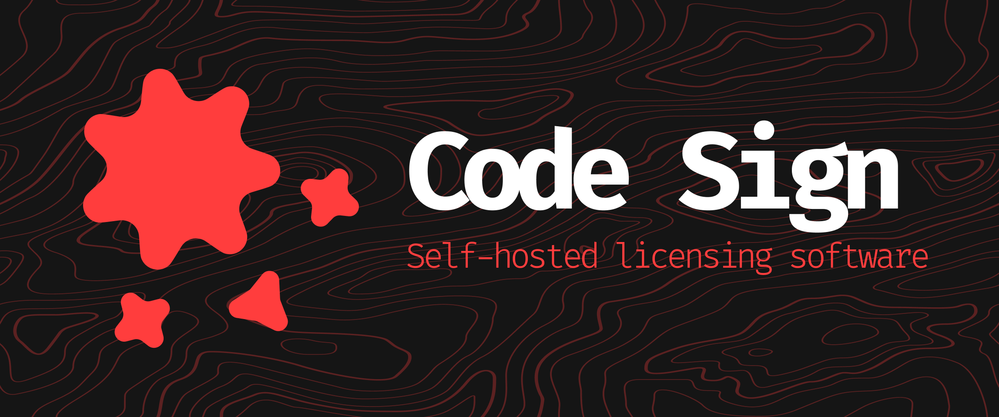

<div align="center">



# Code Sign App

**Manage licensing and code signing processes with ease.**


[](https://github.com/Code-Sign-Labs/app/releases)
[](https://github.com/Code-Sign-Labs/app/commits/main)
[](https://github.com/Code-Sign-Labs/app/issues)

</div>

---

## About

**Code Sign App** is designed to help developers manage their software licensing and code signing workflows efficiently. It provides an intuitive, user-friendly interface that allows teams to seamlessly create, assign, and enforce application licenses.

## Key Features

- **License Management**: Create, assign, and manage licenses for all your software projects.
- **Stripe Integration**: Seamlessly handle payment processing and subscription management.
- **Device Activation System**: Enforce compliance by restricting license activations to a specific number of devices.
- **User-Friendly Interface**: Intuitive, simple UI built to streamline complex workflows.

---

## Getting Started

Choose your preferred setup method below:

<details>

<summary><b>Setup via GitHub Repository</b></summary>


```bash
# 1. Clone the repository
git clone [https://github.com/Code-Sign-Labs/app.git](https://github.com/Code-Sign-Labs/app.git)
cd app

# 2. Copy the environment configuration file
cp .env.example .env

# 3. (Optional) Adjust your environment variables
nano .env

# 4. Start the Docker containers
docker compose up -d --build

# 5. Install PHP dependencies
docker compose exec php composer install

# 6. Verify installation
curl http://localhost:8080/

```

</details>

<details>

<summary><b>Setup via Docker Image</b></summary>

```bash
# 1. Pull the Docker image
docker pull francysdev/codesign-app:latest

# 2. Configure environment variables (if needed)
cp .env.example .env
nano .env

# 3. Run the container
docker run -d -p 8080:80 --name codesign francysdev/codesign-app:latest

# 4. Verify installation
curl http://localhost:8080/

```

</details>

---

## Roadmap

* [x] Complete basic core version of Code Sign App
* [x] Publish Docker image to Docker Hub
* [ ] *More features coming soon!*

To view our full active backlog or contribute to upcoming features, check out our [Trello Board](https://trello.com/b/ign4SDWN/code-sign).

---

## Contributing

We welcome contributions! If you would like to contribute, please check our [Trello Board](https://trello.com/b/ign4SDWN/code-sign) or reach out to us by opening an issue or submitting a Pull Request.